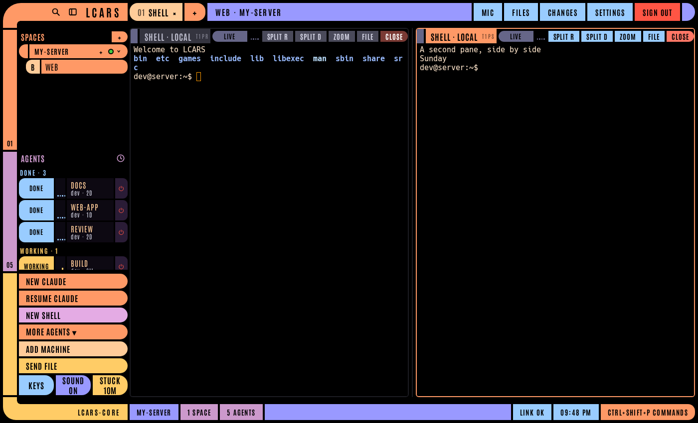
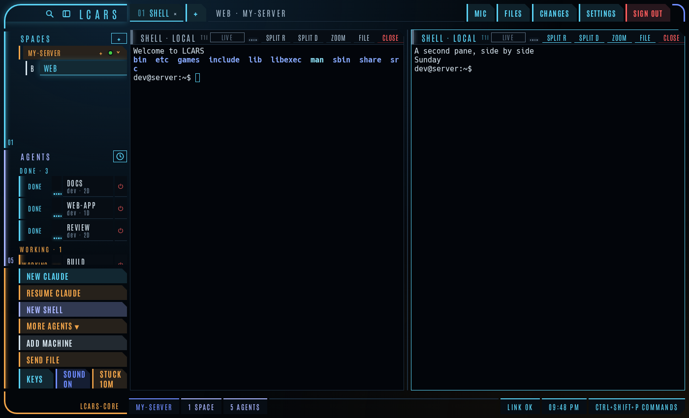
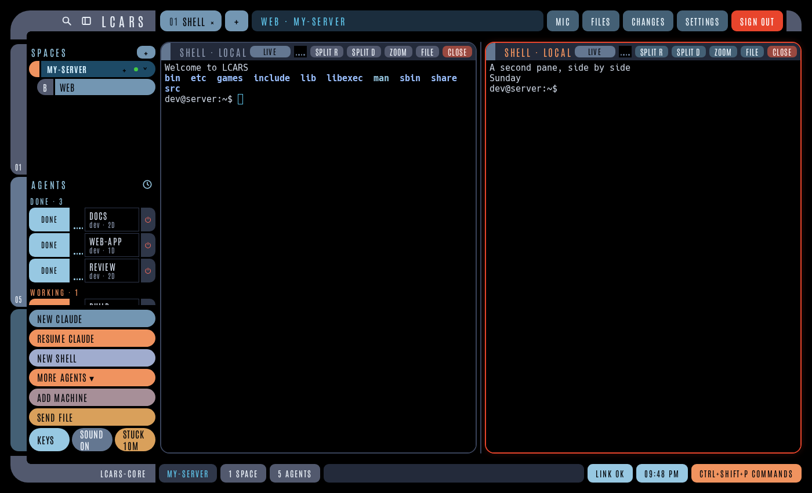

# LCARS-HERDR

 

LCARS-HERDR is a Star Trek LCARS-styled web console for the coding-agent terminals running on a server. Open it in any browser, on a
desktop or a phone, and work with Claude Code, GitHub Copilot, Codex and other agents in real terminals that keep running
when you close the page.



LCARS is an **add-on for [herdr-core](https://github.com/herdrdev/herdr-core)**, which is required. herdr-core keeps the
terminals alive on your machine; LCARS is the web front end for them. It does not talk to any AI model itself and it does
not replace herdr-core or the [Herdr desktop app](https://github.com/herdrdev/herdr-app). It shows the same terminals,
spaces and agents, so you can reach them from places where the desktop app is not available. Install herdr-core first,
following its own instructions, then come back here.

## What you get

- **Spaces, tabs and split panes**, the same model as the Herdr desktop app: split right or down, drag the dividers, drag a
  pane by its header to move or swap it, zoom, rename, close. Closing a pane gives its space to its neighbour.
- **Live agent status** for every terminal (working, needs you, stuck, done, idle) with moving bars, a warning tone when
  an agent needs you, an alarm tone when one may be stuck, and optional browser notifications, so you can see which agent
  is waiting for you without opening it. Quiet interface beeps (new session, prompt taken, file sent, copy, dictation, link) can
  be switched off or turned down.
- **Any coding agent**: pick a default agent (Claude Code, Codex, GitHub Copilot, Grok, OpenCode, Cursor Agent, Amp, Pi,
  Antigravity or Gemini CLI) and start any installed one beside the focused pane, with install and sign-in steps for the ones
  that are not installed yet. Everything works with every agent; a few extras, such as the resume list, are optional add-ons
  for agents that support them.
- **Images and documents**: paste a screenshot (Ctrl+V), drop a file on a pane, or use FILE in its header. The file is saved beside
  the terminal and its path is typed in for the agent.
- **Files and Changes panels**: browse files and view them with syntax colours, see `git` changes and diffs for the pane's
  folder, and commit, on this machine or on another machine you have added.
- **Other machines**: add another computer over SSH and use its terminals in the same window.
- **Voice dictation** into the focused pane, recognised in the browser on your own device.
- **Copy and paste that works in a browser**, including text an agent selects for you.
- **Three looks** (TNG era, Picard era and Titan DS) and a 12 or 24 hour clock, saved to your account, and optional sounds.
- **Accounts with 2FA**: password plus an optional authenticator app, server-side sessions, and an admin who can add users.
- **Phone friendly**: a single-pane view, swipe scrolling, and a touch key bar. Installable as an app from the browser.
- **Layout shared between browsers**: your spaces and panes are stored in the core, so every device shows the same thing.

## Looks

| TNG era | Picard era | Titan DS |
|---|---|---|
|  |  |  |

Pick one in **Settings > Appearance**. It is saved to your account, and the login page follows the last look used on that
browser.

## Requirements

- A Linux machine with **[herdr-core](https://github.com/herdrdev/herdr-core)** installed and working (the `hc` command).
  LCARS needs it on the same machine and cannot work without it.
- **Python 3.10 or newer** with the `venv` module (on Debian or Ubuntu: `sudo apt install python3-venv`).
- **systemd**, if you want the installer to set LCARS up as a service. Without it you can still run it by hand.
- The coding agents you want to use (Claude Code, Codex, and so on), installed and signed in on that machine. LCARS shows you
  the steps for any that are missing.
- A modern browser. Voice dictation needs one with speech recognition (Chrome or Edge).

## Install

```bash
git clone https://github.com/N6LKA/LCARS-HERDR.git
cd LCARS-HERDR
./install.sh
```

The installer checks the requirements, creates a private Python environment in `.venv`, writes a `.env` file with a random
access code (mode 600), and installs and starts a service that comes back after a reboot. It never changes herdr-core.
It is safe to run again: it keeps your `.env` and refreshes the rest.

- Run as **root**, it installs a system service (`/etc/systemd/system/lcars.service`).
- Run as an **ordinary user**, it installs a user service. To keep that running when you are logged out, run
  `sudo loginctl enable-linger $USER` once.

Options (see `./install.sh --help`):

| Option | Meaning |
|---|---|
| `--port N` | Port to serve on (default 7842) |
| `--host ADDR` | Address to listen on (default `0.0.0.0`; use `127.0.0.1` behind a reverse proxy on the same machine) |
| `--no-service` | Set up the files only, and start it yourself |
| `--dry-run` | Show what would happen and change nothing |
| `--uninstall` | Stop and remove the service. Your files and accounts are kept |

### Without the installer

```bash
python3 -m venv .venv
.venv/bin/pip install -r requirements.txt
cp .env.example .env && chmod 600 .env     # then edit LCARS_TOKEN
.venv/bin/python run.py                    # serves on :7842
```

`deploy/lcars.service` is an example systemd unit you can adapt.

### First sign-in

There is no built-in password. Open `http://<your-server>:7842` and the login page asks you to create the first account.

- From a computer on the **same local network**, that is all.
- From **anywhere else**, or through a reverse proxy, it needs a one-time setup code (valid for an hour). Print one on the
  server with `.venv/bin/python -m app.auth setup-code`. It is also written to the service log at first start.

The first account is the admin and can add other users in **Settings**. Turn on 2FA there too.

## Using LCARS

Start with **NEW SHELL** or **NEW AGENT** in the sidebar, then press **F1** for every keyboard shortcut or **Ctrl+Shift+P** for
a searchable list of every command. The full guide, with the sidebar, panes, panels, machines, dictation, copy and paste and a
shortcut table, is in **[docs/GUIDE.md](docs/GUIDE.md)**.

## Configuration

Settings come from the `.env` file next to `run.py`, or from the environment.

| Variable | Meaning |
|---|---|
| `LCARS_TOKEN` | Optional access code for programs running on the same machine. Never accepted from the network. |
| `HOST`, `PORT` | Where to listen (default `0.0.0.0:7842`). |
| `LCARS_TRUSTED_PROXIES` | Address(es) of your reverse proxy, comma separated, so failed-login limits count the real visitor. |
| `LCARS_AGENT_ENV` | A `KEY=value` file (mode 600) of API keys for agents that need one. Default `~/.config/lcars/agents.env`. |
| `LCARS_AUTH_FILE` | Where accounts are kept. Default `auth.json` next to the app. |
| `LCARS_CLAUDE_DIR` | Where Claude Code keeps its sessions. Default `~/.claude`. |
| `HC_SOCKET`, `HC_SESSION` | Which herdr-core to talk to, if you do not use the default one. |

Manage accounts on the server with `.venv/bin/python -m app.auth status | setup-code | reset-2fa USER | set-password USER | remove-all-users`.

### Behind a reverse proxy (HTTPS)

Put LCARS behind HTTPS if you use it from outside your home or office network. With Nginx Proxy Manager, Caddy, Traefik or
similar:

1. Forward to `http://127.0.0.1:7842` (start the installer with `--host 127.0.0.1` if the proxy runs on the same machine).
2. **Turn on WebSocket support.** The terminals and live status use WebSockets and will not work without it.
3. Pass the original `Host` header through. LCARS refuses requests from another origin.
4. Set `LCARS_TRUSTED_PROXIES` to the proxy's address.
5. Voice dictation and the copy button need a secure page, so use HTTPS for those.

An extra login in front, such as Authelia or a VPN, is a good idea: see Safety.

## Updating

```bash
cd LCARS-HERDR
git pull
./install.sh        # refreshes the Python packages and the service
```

If only the files under `app/static` changed, a browser reload is enough. For anything else, restart the service
(`systemctl restart lcars`, or `systemctl --user restart lcars`). Restarting LCARS does not touch your terminals: they
live in herdr-core.

## Troubleshooting

| Problem | What to check |
|---|---|
| The installer says herdr-core was not found | Install [herdr-core](https://github.com/herdrdev/herdr-core) first. `hc ls` should work in a terminal. |
| The page loads but says there is no link or the terminals list is empty | herdr-core is not running for this user. Check `hc ls`, and that the service runs as the same user. |
| The page works but terminals never connect through a proxy | WebSocket support is off in the proxy. |
| "Copy needs a secure page" | Use HTTPS, or press Ctrl+C or Ctrl+Shift+C on a selection, which has a fallback for plain HTTP. |
| The service did not start | `systemctl status lcars` and `journalctl -u lcars -n 50` (add `--user` for a user service). |
| Locked out, or lost the authenticator phone | On the server: `.venv/bin/python -m app.auth reset-2fa USER` or `set-password USER`. |

## How it fits together

```
browser  ->  FastAPI server (this repo, :7842)  ->  herdr-core socket  ->  real terminals
```

- `app/core_client.py` speaks herdr-core's JSON-RPC and framed-stream protocol.
- `app/main.py` is the web server: REST for terminals, WebSockets for live streams and events, uploads and the layout.
- `app/auth.py` is accounts, 2FA and sessions. `app/fs_git.py` is the Files and Changes panels. `app/machines.py` is other machines.
- `app/agents.py` is the list of known coding agents (how to start them, how to install and sign in).
- `app/static/` is the page: xterm.js with no build step.

## Safety

LCARS is a shell on the machine. Anyone who signs in can run anything the service's user can run, so only add people you
trust, keep 2FA on, and never expose it directly to the internet. Put it behind HTTPS and, ideally, a second layer such as a
VPN or an authenticating proxy. Keep each agent's own approval prompts on. Accounts are kept in `auth.json` (mode 600) as
password hashes; sessions are stored hashed and can be revoked in Settings.

## Contributing and security

See [CONTRIBUTING.md](CONTRIBUTING.md) to try a change. Report security problems privately, as described in [SECURITY.md](SECURITY.md).

## Licence

GPLv3 © 2026 Larry Aycock (N6LKA)

This software is free and open source. You may use, modify and redistribute it, but derivative works must remain open source
under the same licence. See [LICENSE](LICENSE) for details.

## Credits and third-party licences

- The look is inspired by the Herdr app's own Star Trek layouts: the **Bridge** layout in
  [eiwe/herdr-layouts](https://github.com/eiwe/herdr-layouts) and the **LCARS** layout in
  [jkuepker/herdr-layouts](https://github.com/jkuepker/herdr-layouts). The Picard and Titan looks follow the style of the
  Star Trek: Picard season 3 console screens and the Titan.DS display system by meWho•Rob.
- Model and shortcuts follow [Herdr](https://github.com/herdrdev/herdr-app) and
  [herdr-core](https://github.com/herdrdev/herdr-core) (Apache-2.0).
- [xterm.js](https://xtermjs.org) (MIT) and [highlight.js](https://highlightjs.org) (BSD-3-Clause, licence in
  `app/static/vendor/highlight.LICENSE.txt`) are vendored in `app/static/vendor`. The Antonio font (SIL OFL 1.1) and Hack font
  (see `app/static/fonts`) are included with their licences.
- Star Trek and LCARS belong to their owners. This is an unofficial, fan-styled interface with no affiliation.
