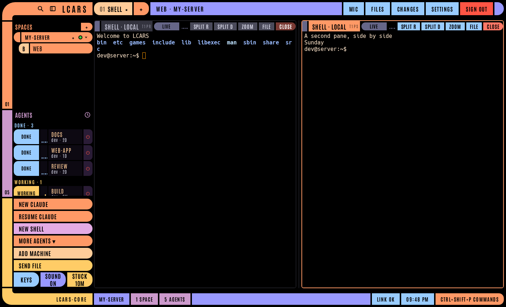

# LCARS guide

How to use LCARS once it is installed. For installing and configuring it, see the [README](../README.md).

## The ideas

LCARS shows the terminals that herdr-core keeps running. It adds nothing between you and the agent: what you type goes to a
real terminal, and the terminal keeps running when you close the page or lose your connection.

| Word | What it is |
|---|---|
| **Space** | A project or workspace. Listed in the sidebar under SPACES. |
| **Tab** | A page inside a space, shown along the top. |
| **Pane** | One terminal. A tab can hold several panes split side by side or one above another. |
| **Agent** | A terminal running a coding agent (Claude Code, Codex and so on). Listed in the sidebar under AGENTS with its status. |
| **Machine** | Another computer you have added over SSH. Its spaces and terminals appear in the same window. |

Your layout (spaces, tabs, pane splits) is saved in herdr-core, so another browser or your phone shows the same thing.

## The screen

- **Top bar**: the tabs of the current space, a **+** for a new tab, then FILES, CHANGES, SETTINGS and SIGN OUT.
- **Sidebar**: SPACES at the top (**+** adds one), AGENTS below with a status for each, then the buttons for starting things.
  Drag its right edge to resize it. Ctrl+Shift+B hides or shows it.
- **Panes**: each has a header with its name, a status, and buttons for SPLIT R, SPLIT D, ZOOM, FILE and CLOSE.
- **Status strip** along the bottom: the machine name, counts of spaces and agents, then MIC, SOUND and STUCK toggles, the
  connection (LINK OK), the clock, and the COMMANDS button.

## Starting things

The buttons at the bottom of the sidebar start sessions beside the focused pane:

- **NEW SHELL**: a plain shell.
- **NEW AGENT**: starts your **default agent**. The button shows its name, for example NEW CLAUDE or NEW CODEX. Choose the
  default in **Settings > Default agent** (it is Claude Code if that is installed, otherwise the first agent that is).
- **RESUME**: shown only when the default agent is one LCARS can list earlier conversations for (today that is Claude Code).
  It opens a searchable list of earlier conversations so you can carry on with one.
- **MORE AGENTS**: any agent LCARS knows (Claude Code, Codex, GitHub Copilot, Grok, OpenCode, Cursor Agent, Amp, Pi,
  Antigravity, Gemini CLI), with a session-name option and "Choose the default agent…". Ones that are not installed show the
  install and sign-in steps instead. LCARS never installs anything itself.
- **Add machine**: the small computer icon beside **+** in the SPACES heading adds another computer (see below).

A dialog asks for an optional name and the folder to start in. The pane header shows the terminal's session name as a small
chip: other agents on the machine can reach that session by name with `hc send`.

For agents that sign in with an API key, put `KEY=value` lines in the agents file (default `~/.config/lcars/agents.env`,
mode 600). Agents started from LCARS get those values.

## Agents: what works with each

Almost everything is the same for every agent, because LCARS shows real terminals: starting, status (working, needs you, done),
stuck detection, splitting and zooming, sending files and images, the Files and Changes panels, copy and paste, dictation,
machines and session names. A few extras need support from the agent itself, so they are optional add-ons:

| Extra | Needs | Today |
|---|---|---|
| A resume list of earlier conversations | LCARS can read that agent's saved sessions | Claude Code |
| The pane name following a rename done inside the agent (`/rename`) | The agent records its own name | Claude Code |

Other agents just do not show these. If you use another agent regularly, its own resume command works in its terminal as
always. Support for more agents can be added in `app/agents.py` (the `caps` entry) when they offer something to read.

## Panes

- **Split**: SPLIT R / SPLIT D in the header, Ctrl+Shift+O (right) and Ctrl+Shift+E (down), or right-click the pane. The
  right-click menu also has **Split right / down with** your default agent, and **Split with another agent…** to pick one.
- **Move**: drag a pane by its header onto another pane to swap or re-split.
- **Resize**: drag the dividers.
- **Zoom**: ZOOM or Ctrl+Shift+Z shows one pane full size; again shows them all.
- **Hide** (right-click menu) removes the pane from the layout but keeps the terminal running. **Close** ends the terminal, and
  the neighbouring pane takes its space.
- **Rename**: double-click the title, or Ctrl+Alt+R. Tabs rename with F2 and spaces with Shift+F2.
- **Status**: WORKING, NEEDS YOU, STUCK?, DONE, IDLE or LIVE. A working agent whose output has not changed for a while is
  marked STUCK?; the STUCK button in the bottom strip cycles how long that takes (or turns it off). The colour and bars also show
  in the sidebar, so you can see which agent is waiting for you. SOUND, also in the bottom strip, turns the alert sounds on and off.

The small code at the right of a pane header is the terminal's real address (for example `t7`, or `name/t7` on another machine),
useful with the `hc` command.

## Files and Changes

**FILES** (Ctrl+Alt+F) opens a read-only browser for the focused pane's folder: open folders, view text files. **CHANGES**
(Ctrl+Alt+G) shows `git` status and diffs for that folder and lets you commit. Both run as the same user as the terminals, so
they add no access that a terminal does not already have. They refuse `/proc`, `/sys` and `/dev`.

## Sending files and images

- **Paste** a screenshot or copied image with Ctrl+V.
- **Drop** a file onto a pane, or use **FILE** in its header.

The file is stored beside the terminal and its path is typed in, so you can tell the agent "look at this". Files can be up to
8 MB.

## Other machines

**Add machine** (the computer icon in the SPACES heading) asks for an SSH address (for example `user@192.0.2.50`) and a name. herdr-core connects over SSH, and the
machine's spaces and terminals then appear in the sidebar under its own heading, with a status dot. If the other machine
needs to trust this server first, the dialog shows a command that authorises this server's SSH key there. A machine can be renamed, reconnected or removed from the
same place.

## Copy and paste

- **Copy**: select text with the mouse, then press **Ctrl+C**. With text selected it copies (and clears the selection); with
  nothing selected Ctrl+C still interrupts the program as usual. **Ctrl+Shift+C**, **Ctrl+Insert** and the right-click **Copy**
  also work.
- **Programs that select text themselves** (Claude Code in full-screen mode, tmux, vim): what they copy reaches your clipboard
  through the terminal's OSC 52 request. To use LCARS's own selection in a full-screen program, hold **Shift** while dragging.
- **Paste**: Ctrl+V, or right-click **Paste**. A pasted image is sent as a file.

Copying needs HTTPS or localhost for the browser's clipboard, but has a fallback that works on plain HTTP.

## Voice dictation

**MIC** in the bottom strip (or Ctrl+Alt+M) turns speech into text typed at the focused pane. Recognition happens in the browser on your device.
Say "period", "comma" or "question mark" for punctuation, and "press enter" to send. It needs a browser with speech recognition
(Chrome or Edge) and microphone permission, on HTTPS or localhost.

## On a phone

On a narrow screen LCARS shows one pane at a time. Swipe sideways on a pane header to change pane, and drag to scroll;
full-screen programs scroll too. The key bar under the pane is a touch bar with keys a phone keyboard lacks (Esc, Tab, Ctrl+C, arrows, Enter). Use
your browser's **Install** option, or the command **Install LCARS as an app**, to add it to your home screen.

## Settings

Open **SETTINGS** in the top bar.

- **Appearance**: TNG era, Picard era or Titan DS. Saved to your account.
- **Clock**: 12 or 24 hour. Saved to your account.
- **Default agent**: which agent the NEW button, the tab menu and the split commands start. Saved to your account.
- **Account**: change your password or username, turn on **2FA** with an authenticator app (you get one-time recovery codes),
  see where you are signed in, and sign out other sessions.
- **Users** (admins only): add and remove users. Every user can use the machine's terminals, so add only people you trust.

## Command palette and finder

- **Ctrl+Shift+P**, F1 or the **COMMANDS** button at the bottom right opens one searchable list of every command, grouped,
  each with its shortcut. Type to filter, Enter or a click runs it.
- **Ctrl+Shift+K** finds a space, tab or agent by name and jumps to it.

## Keyboard shortcuts

Where a browser keeps a shortcut for itself, a Ctrl+Alt twin is provided (new tab, close tab, new space).

| Do this | Shortcut |
|---|---|
| Command palette / finder / shortcut list | Ctrl+Shift+P / Ctrl+Shift+K / F1 |
| Dictation on or off | Ctrl+Alt+M |
| Files panel / Changes panel | Ctrl+Alt+F / Ctrl+Alt+G |
| New space / new tab / close tab | Ctrl+Shift+N / Ctrl+Shift+T / Ctrl+Shift+W (or the Ctrl+Alt twin) |
| Go to tab 1 to 9 | Ctrl+1 to 9 (or Ctrl+Alt+1 to 9) |
| Go to space 1 to 9 | Alt+1 to 9 |
| Next / previous tab | Ctrl+PageDown / Ctrl+PageUp, Ctrl+Tab / Ctrl+Shift+Tab |
| Next / previous space | Ctrl+Shift+PageDown / Ctrl+Shift+PageUp |
| Next / previous agent | Alt+Down / Alt+Up |
| Split right / split down | Ctrl+Shift+O / Ctrl+Shift+E |
| Move between panes | Alt+H J K L, or Alt+arrows |
| Swap pane with a neighbour | Alt+Shift+H J K L |
| Zoom pane / close pane | Ctrl+Shift+Z / Ctrl+Shift+X |
| Rename pane / tab / space | Ctrl+Alt+R / F2 / Shift+F2 |
| Show or hide the sidebar | Ctrl+Shift+B |
| Bigger / smaller / reset terminal text | Ctrl+= / Ctrl+- / Ctrl+0 |
| Copy / paste | Ctrl+C on a selection, Ctrl+Shift+C / Ctrl+V |

## Tips

- Leave an agent working and come back later: the sidebar shows which ones are DONE or NEEDS YOU.
- Use one space per project and one tab per task.
- Keep a shell pane next to each agent for running tests and checking its work.
- If the page ever says the link is down, your terminals are still running: reload and they are all still there.
